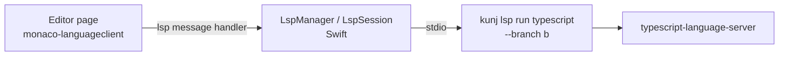

# Language servers in the workspace app

*Decided 2026-11-04.* The workspace app's editor tabs get go to definition, find references, hover and
diagnostics from real language servers. Servers run only while they are being used: they start with an
editor tab, stop when idle, and at most three run at once, so a day with many worktrees open does not
hold gigabytes of tsserver. The search-based go to declaration ([workspace-ide.md](workspace-ide.md))
stays as the fallback.

## Status

| Part | State |
| --- | --- |
| 1. Editor on monaco-vscode-api (option B, no visible change) | To do |
| 2. CLI: `kunj lsp list` / `kunj lsp run`, `lsp.servers.*`, `LspListJson` | To do |
| 3. App: `LspSession` bridge, URI guard, `LspManager` lifecycle; definition, references, hover, diagnostics | To do |
| 4. App: the Changes diff, status bar memory, Language Servers menu | To do |

Each part ships and is reviewed on its own, in this order.

## Scope

- **Languages:** any, configured per language. kunj ships defaults for TypeScript/JavaScript, Swift, Go
  and C/C++.
- **Environments:** worktrees only. A server runs on the Mac with the worktree as its root. Branch
  containers keep the search-based jump; `kunj lsp run` is where container support goes later (through
  `kunj ct exec`), without the app changing.
- **Features in v1:** go to definition (⌘-click, F12), find references (⇧F12: Monaco's peek widget, and
  opening a result in an editor tab), hover, diagnostics. Not in v1: completion, rename, code actions,
  formatting.

## 1. Editor on monaco-vscode-api

`workspace-app/web` moves from `monaco-editor` 0.57 (AMD, `copy-monaco.js`) to a Vite build of
`@codingame/monaco-vscode-api` and `monaco-languageclient`, every `@codingame/*` package pinned to the
same version. It follows [the spike's report](../../spikes/monaco-vscode-api/REPORT.md):

- Vite `base: './'`, `worker.format: 'es'`, `build.target: 'esnext'`, `assetsInlineLimit: 0`; the output
  goes to `Resources/web/` and is served by `AppSchemeHandler` as today.
- The colour themes become VS Code colour themes generated from `tokens.json` (no `defineTheme`).
- A model's language comes from its file URI; worker labels are explicit (`editorWorkerService`); the
  page waits for the extensions' `whenReady()` before creating editors.
- Cost measured by the spike: about +0.4 s on first load and +30 MB per web view.

This part changes nothing the user sees: the same editor and diff tabs, ⌘-click still searches. It ships
first so a regression points at the move, not at language servers.

## 2. CLI: `kunj lsp`

```bash
kunj lsp list [--json]                  # configured languages, installed or not, restart class
kunj lsp run <language> [--branch <b>]  # runs the server in the worktree, stdio passed straight through
```

Both are on the fast path (src/commands/fast.ts).

**Settings.** `lsp.servers.<language>`:

| Field | Meaning |
| --- | --- |
| `command` | argv array; run with the worktree root as cwd, no shell |
| `extensions` | file extensions this server handles (`.ts`, `.tsx`, …) |
| `restart` | `cached` (keeps an index on disk, cheap to restart) or `cold` (re-reads the project) |
| `cachePaths` | paths relative to the worktree the server writes its cache to |

A user setting replaces kunj's default for that language field by field. Defaults:

| Language | Command | Restart | Cache |
| --- | --- | --- | --- |
| `typescript` (ts, tsx, js, jsx, mjs, cjs, mts, cts) | `typescript-language-server --stdio` | `cold` | — |
| `swift` | `sourcekit-lsp` | `cached` | `.build/` |
| `go` | `gopls` | `cached` | — (`~/Library/Caches/gopls`, shared by worktrees) |
| `cpp` (c, h, cc, cpp, cxx, hpp, hh, m, mm) | `clangd` | `cached` | `.cache/clangd/` |

The settings `lsp.idleStopMinutes.cached` (5), `lsp.idleStopMinutes.cold` (15),
`lsp.closedStopMinutes` (2), `lsp.maxServers` (3) and `lsp.readyTimeoutMs` (1500) are read by the app
through `kunj lsp list --json`.

**`run`.** Resolves the worktree of `--branch` (default: the current one), finds `command[0]` on PATH,
adds each `cachePaths` entry to the repository's `info/exclude` (anchored, once) so a cache inside the
worktree never shows in `git status` or triggers `kunj events`, and execs the server with stdio
inherited. A missing program fails with the code `lsp-missing` and the install command in the hint
(`npm i -g typescript-language-server typescript`, `go install golang.org/x/tools/gopls@latest`, Xcode
for sourcekit-lsp, `xcode-select --install` for clangd). An unknown language is `lsp-unknown`.

**`LspListJson`** (added to src/lib/json-types.ts; fields only ever added):

```ts
interface LspListJson {
  servers: { language: string; command: string[]; extensions: string[];
             restart: 'cached' | 'cold'; cachePaths: string[]; installed: boolean; path?: string }[];
  idleStopMinutes: { cached: number; cold: number };
  closedStopMinutes: number;
  maxServers: number;
  readyTimeoutMs: number;
}
```

## 3. The bridge and the lifecycle



**`LspSession`** (KunjWorkspaceCore) owns one `kunj lsp run` child: it parses and writes LSP's
`Content-Length` framing, relays messages between the child and the pages, and keeps the documents the
pages have open so it can replay `didOpen` after a restart.

**Page ↔ Swift.** The page's language client talks through a message transport on the `kunj` handler:
`{type: 'lsp', tab, message}` up, `window.kunj.lsp(message)` down. Swift remembers which tab sent which
request id and routes the reply back to it; server notifications (diagnostics) go to every tab of that
environment and language.

**The URI guard.** The page may still never name a file Swift has not chosen:

- Every `textDocument.uri` from the page must be a `file://` URI inside the environment's worktree, and
  `didOpen` only for a document open in one of that environment's tabs. Anything else is dropped.
- Requests the server sends to the client are answered by Swift: `workspace/configuration` with empty
  settings, `workspace/workspaceFolders` with the worktree, and `workspace/applyEdit`,
  `window/showDocument` and file operations refused.
- Opening a result (definition, a reference) is a message to Swift with the location; Swift opens it only
  when the location is inside the worktree or is one the server returned in the last reply to that tab.
  A location outside the worktree (Go's standard library, an SDK header) opens read-only.
- The references peek widget reads other files through the same check (`{type: 'lspRead', tab, uri}`).

**`LspManager`** (KunjWorkspaceCore, a clock injected for tests) keys servers by (environment,
language):

| Event | Action |
| --- | --- |
| An editor tab of a configured, installed language opens | start the server if it is not running |
| The last tab of that language in that environment closes | stop after `closedStopMinutes` (2) |
| No request for `idleStopMinutes` (5 cached, 15 cold) with tabs open | stop; the tabs stay |
| A request reaches a stopped server | start it, replay `didOpen`, then send |
| A start would exceed `maxServers` (3) | stop a `cached` server first, else the least recently used |
| The server is not ready within `readyTimeoutMs` | that action uses the search fallback |
| The server exits unexpectedly | restart, at most twice in 5 minutes; then "language server failed" and search until a tab of that language reopens |
| The app quits | `shutdown` + `exit` to each, kill after 2 s |

Stopping is a real stop, not a pause: a stopped (SIGSTOP) process keeps its memory. A `cached` server
rebuilds from its disk cache on the next start, which is why it is stopped sooner and evicted first; the
TypeScript server has no disk cache and re-reads the whole project, so it is kept longest.

## 4. The Changes diff and visibility

- The diff's modified side of a worktree file uses the language server only when one is already running
  for that environment and language; the diff never starts one. The original side, container files,
  languages with no installed server and slow starts use the search-based jump.
- The status bar shows the running servers and their memory (the child's RSS, sampled every 10 s while
  any run). Session > Language Servers lists them with a Stop item each.

## Testing

- KunjWorkspaceCore (Swift Testing): framing split across reads and several messages in one read; the URI
  guard; request-id routing; every row of the lifecycle table against a fake clock; replay after restart.
- `Tests/Fixtures/fake-lsp`: a small server script that answers `initialize`, `definition` and
  `shutdown`, used through a fake `kunj lsp run`.
- Jest: `lsp.servers` resolution and merging, `lsp list --json` with a missing program, `lsp-missing`,
  the `info/exclude` lines written once.
- No functional tests unless asked.

## Open questions

- Kotlin (`kotlin-language-server`, which has an on-disk cache) and Python (`pyright`, `cold`) as further
  defaults.
- The TypeScript native server (tsgo) as the TypeScript default once it is stable: it starts faster and
  uses far less memory than tsserver.
- Container environments through `kunj ct exec` in `kunj lsp run`.
