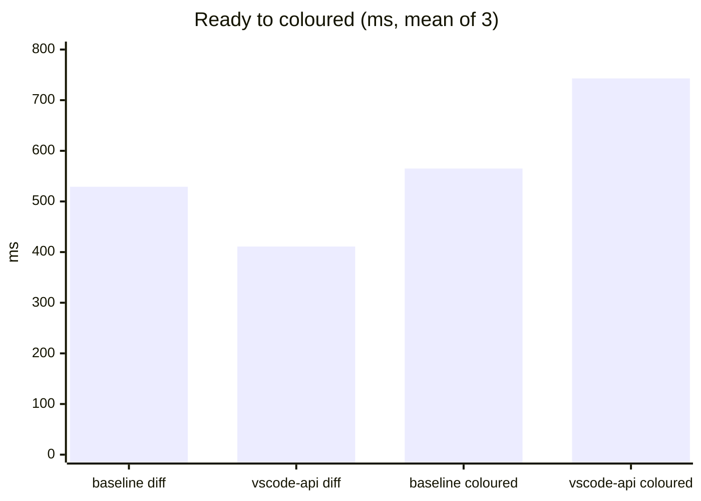

# monaco-vscode-api spike (option B: editor only)

Question: can the workspace app replace `monaco-editor` 0.57 (AMD `min/vs`, Monarch tokenizers) with
[`@codingame/monaco-vscode-api`](https://github.com/codingame/monaco-vscode-api) used as an editor
only (VS Code's configuration, languages, TextMate and theme services, the default language
extensions, no workbench, no extension host, no language servers), inside a WKWebView served from
the app's custom scheme?

**Answer: yes.** Both editors render, TextMate colours every language tried, the diff runs in the
editor worker, a kunj theme registered as a VS Code colour-theme extension applies and switches live,
and nothing needs cross-origin isolation. Memory and load time are about the same as today. Two
things in `app.js` must change: theming (`defineTheme` is gone) and, optionally, the language table.

Machine: Apple Silicon MacBook Pro, macOS 26, Swift 6.4, the WebKit that ships with macOS 26. Versions:
`@codingame/monaco-vscode-*` **38.0.4** (all packages one version), Vite 8.3.5; baseline
`monaco-editor` **0.57.0**. Raw results: `results/*.json`. Screenshots: `screenshots/`.

## How to run

```bash
cd spikes/monaco-vscode-api
(cd web && npm ci && npm run build)                              # -> web/dist
cp -R ../../workspace-app/web/node_modules/monaco-editor/min/vs baseline/vs   # after npm ci there
swift build -c release
B=$(swift build -c release --show-bin-path)/MonacoVSCodeSpike
$B --root web/dist --out results/vscode-api-1.json --shot screenshots/vscode-api.png
$B --root baseline --out results/baseline-1.json --shot screenshots/baseline.png
#   --coi adds COOP/COEP headers (not needed for anything here)
```

The harness (`Sources/MonacoVSCodeSpike/main.swift`) opens a 1200x700 window with one WKWebView, serves
`--root` under `kunj://app/` the way `AppSchemeHandler` does, waits for the page's `result` message,
waits 3 s more, then records the WebContent process footprint (`/usr/bin/footprint`) and a snapshot.
Both pages do the same work: a TypeScript editor on the left, a read-only inline Swift diff on the
right (`hideUnchangedRegions`), then wait until both show more than a handful of token classes.

## Results

Three runs each, alternating; times are ms from the page script starting.

| | Baseline (AMD 0.57, Monarch) | monaco-vscode-api 38 (TextMate) |
|---|---|---|
| Services ready (`initialized`) | 184 / 190 / 176 | 45 / 37 / 46 |
| Diff computed (`diff`) | 505 / 506 / 577 | 441 / 403 / 388 |
| Both editors coloured (`tokenised`) | 558 / 507 / 629 | 753 / 766 / 709 |
| WebContent footprint | 311 / 316 / 302 MB | 335 / 336 / 337 MB |
| Requests to the scheme handler | 25 | 74 (grammars and theme JSON load on demand) |
| On disk | `min/vs` 25 MB | `dist` 11 MB (8.5 MB of JS; main chunk 7.3 MB, 1.9 MB gzip) |
| Workers | none created by this page (TS worker not asked for) | `editorWorkerService`, `TextMateWorker` (module workers, onig wasm) |



TextMate colours about 180 ms later than Monarch because the grammar JSON and the oniguruma wasm load
and compile in a worker; it does not block the main thread. Memory is +25 MB (8%) for the WebContent
process. The page also loads 14 language extensions; trimming that list trims the grammars, not the
7 MB core.

Screenshot (`screenshots/vscode-api.png`): TypeScript and Swift are coloured by their VS Code grammars
with the spike's kunj token colours; the inline diff has word-level highlights and `+`/`−` gutters.

## Findings

1. **WKWebView + custom scheme works as is.** ES module scripts, module workers created from
   `new URL(…, import.meta.url)`, the `.wasm` files (served with UTType's MIME) and the `crossorigin`
   attributes Vite writes all load through `kunj://app/`. No COOP/COEP needed (`crossOriginIsolated`
   is false); that is only required for TypeScript's project-wide IntelliSense, which option B does
   not include.
2. **Worker labels differ from the docs.** The getting-started guide names `TextEditorWorker`; 38.0.4
   asks for `editorWorkerService`. With the wrong label Monaco silently falls back to running the
   diff on the main thread (a console warning only). Map unknown labels loudly.
3. **Wait for the extensions.** Language and theme extensions register asynchronously. Await each
   default extension's exported `whenReady()` before creating models, or a model created with a
   language the registry does not know yet stays uncoloured.
4. **`monaco.editor.defineTheme` / `setTheme` are gone** (`defineTheme is not a function`) once the
   theme service override is in. The app's live themes (built from `tokens.json`) must become VS Code
   colour themes: `registerExtension({ contributes: { themes: [...] } })` with the JSON registered as
   a blob URL, then `updateUserConfiguration({ "workbench.colorTheme": … })` to switch. Switching
   that way applied immediately in the spike. Token rules become TextMate scopes (`keyword`,
   `storage.type`, `string`, `entity.name.type`, …) rather than Monarch token names.
5. **Language from the file name.** A model created with no language and a `file:///…/<name>` URI gets
   the right id from the language extensions: `Package.swift`→swift, `Dockerfile`→dockerfile,
   `.zshrc`→shellscript, `x.tsx`→typescriptreact, `x.yml`→yaml, unknown→plaintext. `app.js`'s
   `BY_EXT`/`BY_NAME` table can go, but the ids change (`shell`→`shellscript`, `tsx` is
   `typescriptreact`). `monaco.languages.getLanguages()` returns only `plaintext` here; ask the
   language service, not the standalone registry.
6. **One version for everything.** Every `@codingame/monaco-vscode-*` package must be exactly the same
   version (`npm ls @codingame/monaco-vscode-api`). Majors come about monthly with VS Code; pin
   exactly and upgrade them together.
7. **Build step.** The app gains a Vite build (`web/` → `Resources/web/`), replacing `copy-monaco.js`.
   It needs `base: './'`, `worker.format: 'es'`, `build.target: 'esnext'` (top-level await) and
   `assetsInlineLimit: 0`; the main chunk is large but loaded once from disk.
8. **Harness note, not a library issue.** WebKit does not run `requestAnimationFrame` for an occluded
   window, and Monaco draws lines in a frame callback, so a window behind other apps renders nothing
   (the baseline too). The harness floats its window and calls the private
   `_setWindowOcclusionDetectionEnabled:` (guarded by `responds(to:)`; setting it by KVC threw inside
   `applicationDidFinishLaunching` and the run hung).

## Not measured

- Two WKWebViews in one process pool (the app's Changes column and editor tabs) with the new bundle.
- Editing behaviour beyond what loading shows: ⌘S, find, keybindings with the keybindings override,
  line endings and BOM, large files, the `?mode=editor` page's dirty/save messages.
- The app's actual `app.js` ported: this page is a stand-in with the same two editors.
- Language servers (option C) and the cross-origin isolation they would need for TypeScript.

## Recommendation

Adopt option B in the workspace app as the AMD→ESM move: port `app.js` to a Vite-built module, turn
`tokens.json` themes into generated VS Code colour themes, drop the extension table in favour of
URI-based language detection, map worker labels explicitly, and await the extensions before the
`ready` message. Then measure the two-view case in the app itself.
